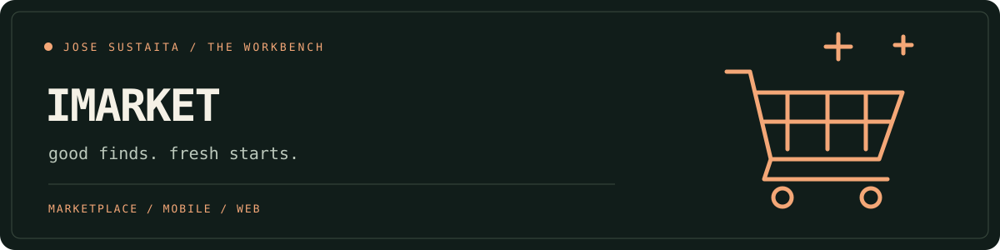

<p align="center"></p>

# I Market ✦

**Discover lost treasure.** A neighborhood marketplace inspired by Immokalee, Florida: give once-loved things another chapter. This repo contains the original Expo/React Native app and a new, self-contained browser demo.

## One-command browser demo

Prerequisite: **Docker with Compose v2**. Use Bash/WSL for the helper.

```bash
git clone --depth 1 https://github.com/josesustaita/ImarketApp.git
cd ImarketApp
./scripts/bootstrap.sh
```

Open **http://localhost:8081**. The script checks Docker, creates `.env` from the example if needed, builds and tests the browser app, and waits for a healthy web server. Existing settings are preserved. No local Node installation, account, API key, or marketplace backend is needed. First build downloads dependencies and images.

### Take it for a spin

- Browse six illustrated neighborhood sample finds.
- Search and filter by Home, Music, Outdoors, or Tech.
- Save a heart and open **Saved finds** to build a little treasure chest.
- Open a listing for details; close it with the close button or Escape.
- Select **List a little treasure** to create a browser-local demo listing.

The web demo uses sample listings. New listings and saved hearts persist in **this browser's local storage**, not on a public server. It does not process purchases, send seller messages, or connect to the original mobile backend. Clearing site data clears those demo changes. The animated illustrations and card interactions respect `prefers-reduced-motion`.

## Run, inspect, stop

```bash
./scripts/bootstrap.sh doctor
./scripts/bootstrap.sh logs
./scripts/bootstrap.sh test   # build tests + health check; leaves the app running
./scripts/bootstrap.sh down
IMARKET_PORT=8091 ./scripts/bootstrap.sh
```

Edit `IMARKET_PORT` in `.env` to keep a custom port. The server binds to loopback. `down` stops/removes containers and the project network; it preserves cached images and browser-local demo data.

## Browser development

Use **Node 22.12+**; Docker uses Node 22.

```bash
cd web
npm ci
npm test
npm run dev
# Build the production site:
npm run build
```

Vite prints the development URL. The production Docker image serves the built static files with unprivileged nginx. The tests cover combined search/category/saved filters, listing validation, and corrupt browser storage.

## Original mobile application

`App.js` and `app/` retain the original React Native app: authentication, listing feeds, item details, posting, seller messages, image selection, and offline caching. The welcome screen now has a short reveal animation that honors the device's reduced-motion setting.

The mobile project uses **Expo SDK 40 / React Native 0.63 / React 16**. It is a legacy source project, not the Docker web target. It needs its matching historical toolchain/client and the separate backend, which is not included in this repository; current Expo Go does not run SDK 40. The browser demo gives you an immediately runnable path while preserving that work. Android/iOS builds have not been validated as part of this refresh.

The mobile API URL is now configured through `app.config.js`:

```bash
IMARKET_API_URL=http://YOUR-LAN-HOST:9000/api npm start
```

A physical phone cannot use your computer's `localhost`; use a reachable LAN hostname or IP. The native client expects the existing backend's auth, users, listings, messages, and push-token endpoints. There is no backend container in this repo, and the web demo does not pretend to implement those APIs. See [the development notes](docs/DEVELOPMENT.md) for the source map and native caveats.

## Project map

- `web/src/` — React browser demo, local storage, search/filter logic, and SVG item art.
- `web/test/` — demo behavior tests.
- `app/screens/`, `app/components/` — original native screens and components.
- `app/api/`, `app/auth/` — backend client, token storage, and authentication flow.
- `app/assets/` — original branding and Lottie animations.
- `Dockerfile`, `compose.yaml`, `scripts/bootstrap.sh` — browser bootstrap.
- `docs/banner.svg` — animated local README artwork.

Generated `node_modules` and `.expo` files are now ignored instead of versioned. Install dependencies from the relevant lockfile (`web/` for the browser, root for the legacy mobile app).

## Troubleshooting

- **Docker not running:** start the daemon and run `doctor`.
- **Port already used:** change `IMARKET_PORT` in `.env` and rerun the bootstrap.
- **Saved finds reset:** check that you are using the same browser and port and that local storage is allowed.
- **Native auth/listings fail:** check the configured backend URL; the Docker web demo is independent of the mobile API.

For browser contributions, run `npm test` and `npm run build` from `web/`. Licensed under [MIT](LICENSE).
